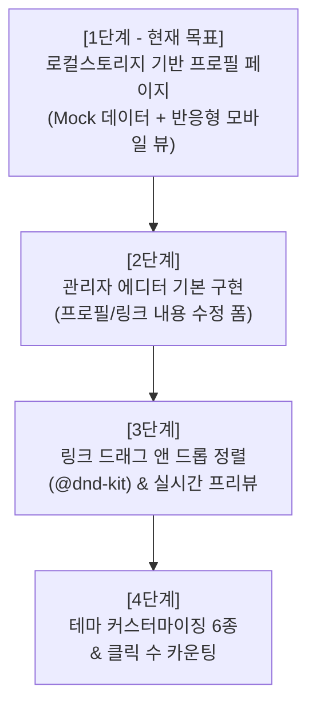

# [PRD] 마이링크 (MyLink) - 멀티 링크 바이오 서비스 (1단계: 시연용 프로필 페이지)

## 1. 프로젝트 개요 (Overview)
- **서비스명**: 마이링크 (MyLink)
- **진행 방식**: 단계별 점진적 구축 (Step-by-Step)
- **1단계 목표**: **브라우저 로컬 스토리지(LocalStorage)와 Mock 데이터를 활용한 '모바일 최적화 퍼블릭 프로필 페이지' 완성 및 시연**
- **개념**: 별도의 복잡한 백엔드나 에디터 기능 없이도, 로컬 스토리지에 저장된 사용자 프로필(사진, 이름, 소개글), 소셜 아이콘, 링크 목록을 읽어와 스마트폰 화면에 꼭 맞는 깔끔한 멀티 링크 페이지로 시각화하여 시연할 수 있도록 구현

---

## 2. 사용자 시나리오 (User Scenarios & Journeys)

### 2.1 [시나리오 A] 방문자 / 팔로워 관점 (End-User Experience)
> **"인스타그램에서 크리에이터의 프로필 링크를 누르고 들어온 팬(방문자)"**

1. **유입 (Traffic Inflow)**:
   - 방문자는 크리에이터의 인스타그램/유튜브 소개글에 적힌 `마이링크` 주소를 탭합니다.
   - 인앱 브라우저(In-App Browser) 또는 모바일 웹 브라우저 환경에서 1초 미만으로 지연 없이 첫 화면이 로딩됩니다.
2. **프로필 및 정체성 확인 (Identity Check)**:
   - 화면 상단에서 크리에이터의 대표 프로필 사진, 닉네임, 그리고 줄바꿈이 적용된 웰컴 메시지(Bio)를 한눈에 확인합니다.
   - 프로필 하단의 소셜 아이콘 바(Instagram, YouTube, GitHub 등)를 보고 크리에이터가 활동하는 다른 채널들도 파악합니다.
3. **목적 링크 탐색 및 인터랙션 (Link Engagement)**:
   - 세로로 보기 편하게 배열된 링크 카드(이모지, 제목, 외부링크 아이콘)들을 스크롤합니다.
   - 마음에 드는 링크(예: "2026 생산성 툴 베스트 5 노션", "커피 한 잔 후원하기")를 터치합니다.
   - 카드가 살짝 눌리는 시각적 피드백(터치 반응)과 함께, 기존 마이링크 창은 유지된 채 **새 창(탭)으로 목적지 페이지가 즉시 열립니다.**
4. **쾌적한 잔여 탐색 (Return)**:
   - 외부 페이지를 확인한 후 다시 이전 탭으로 돌아왔을 때도 프로필 화면이 새로고침 없이 그대로 유지되어 다른 링크를 연속으로 탐색할 수 있습니다.

---

### 2.2 [시나리오 B] 크리에이터 / 데모 시연자 관점 (Creator & Presenter)
> **"마이링크 서비스를 테스트하고 다른 사람에게 시연하는 발표자/크리에이터"**

1. **무설치·무가입 즉시 접속 (Zero-Setup Experience)**:
   - 시연자는 웹 브라우저를 열고 서비스 주소로 접속합니다.
   - 복잡한 회원가입이나 로그인 폼 없이, `localStorage`에 데이터가 없음을 감지하여 **고품질 Mock 데이터(완성형 프로필, SNS 4개, 링크 4개)가 0.1초 만에 자동 주입**되어 완성도 높은 프로필 화면이 나타납니다.
2. **디바이스 반응형 확인 (Responsive Test)**:
   - **스마트폰/모바일 환경**: 화면 전체를 꽉 채우며 안전 영역(Safe Area)을 준수하는 자연스러운 네이티브 앱 느낌 확인.
   - **PC/데스크톱 환경**: 화면 중앙에 480px 폭의 깔끔한 스마트폰 카드 뷰 형태로 플로팅되어 가독성을 유지하는 모습 확인.
3. **데이터 영속성 시연 (Persistence Demonstration)**:
   - 시연자가 브라우저를 강력 새로고침(`F5`)하거나 창을 닫았다 다시 열어도, 로컬 스토리지에 데이터가 영구 보존되어 깜빡임(Hydration Mismatch) 없이 매끄럽게 렌더링됨을 시연합니다.
4. **시연용 데이터 초기화 (Reset Control)**:
   - 시연 도중 상태를 초기 깨끗한 상태로 되돌리고 싶을 때, 화면 우측 하단의 `[기본 Mock 데이터로 재설정]` 플로팅 버튼을 클릭합니다.
   - "초기 데이터로 복원되었습니다" 안내와 함께 즉시 기본값으로 화면이 갱신됩니다.

---

### 2.3 [시나리오 C] 엣지 케이스 및 예외 처리 (Edge Cases)
- **긴 텍스트 입력 시**: 제목이 두 줄 이상으로 길어지더라도 카드 높이가 유연하게 늘어나거나 말줄임표 처리되어 레이아웃이 깨지지 않음.
- **비활성화된 링크(`isActive: false`)**: 에디터 데이터에 존재하더라도 퍼블릭 뷰에서는 렌더링에서 완전히 제외됨.
- **오프라인/네트워크 불안정 환경**: 로컬 스토리지 기반이므로 인터넷 연결이 끊겨도 프로필 화면과 UI는 정상적으로 렌더링됨.

---

## 3. 1단계 기능 요구사항 (Functional Requirements)

### 3.1 프로필 헤더 (Profile Header)
- **아바타 이미지**: 원형 프로필 이미지 (기본 고화질 Unsplash 샘플 이미지 또는 로컬 자산)
- **표시 이름 (Display Name)**: 크리에이터 닉네임 (예: `김링크 | Digital Creator`)
- **한 줄 소개 (Bio)**: 프로필 하단에 줄바꿈을 지원하는 깔끔한 소개 문구 (예: `나다운 삶을 만드는 생산성 꿀팁과 일상을 기록합니다 🌿`)

### 3.2 소셜 아이콘 바 (Social Icons)
- 프로필 소개글 바로 하단에 가로로 나열되는 미니멀한 브랜드 아이콘 바
- 지원 플랫폼 (1단계):
  - Instagram, YouTube, X(Twitter), GitHub, 이메일(mailto:)
- 호버 및 탭 시 부드러운 스케일 업 애니메이션 효과 (`transition-transform hover:scale-110`)

### 3.3 링크 버튼 목록 (Link Cards)
- 세로로 나열되는 터치 친화적 링크 카드 목록
- 각 카드 구성:
  - **좌측**: 이모지 또는 아이콘 (예: 📝, ☕, 💼, 📺)
  - **중앙**: 링크 타이틀 텍스트 (명확한 가독성)
  - **우측**: 외부 이동 표시 아이콘 (`ExternalLink` 아이콘)
- **인터랙션**:
  - 마우스 호버 / 모바일 터치 시 카드 리프트(그림자 및 약간의 Y축 이동) 피드백
  - 클릭 시 지정된 URL로 새 창(`target="_blank" rel="noopener noreferrer"`) 이동
  - 활성화(`isActive: true`)된 링크만 화면에 노출

### 3.4 레이아웃 및 디자인 시스템 (shadcn/ui 기반)
- **디자인 시스템 기반**:
  - **shadcn/ui** (Tailwind CSS v4 + `@base-ui/react` 기반)를 전면 채택하여 일관된 디자인 시스템 구축
  - 모든 인터랙티브 요소(버튼, 카드, 아바타, 다이얼로그, 토스트 등)는 shadcn/ui 표준 컴포넌트를 확장하여 사용
  - CSS-first 방식의 테마 토큰(`globals.css`의 CSS 변수 및 `@theme`)을 통해 일관된 폰트, 색상, 반경(Radius), 간격 관리
- **스타일링 원칙**:
  - **CSS Module 사용 금지** — 모든 스타일은 **Tailwind CSS 유틸리티 클래스**로만 작성
  - 프로젝트 내 `.module.css` 파일을 허용하지 않으며, 인라인 `style` 속성도 최소화
  - 디자인 토큰(`--color-*`, `--radius-*` 등)은 `globals.css`의 `@theme` 블록에서 관리하고 Tailwind 클래스로 참조
- **컴포넌트 재사용 원칙**:
  - UI 요소는 shadcn/ui 베이스 컴포넌트를 확장한 **재사용 가능한 컴포넌트**로 분리하여 `src/components/ui/` 디렉터리에 배치
  - 현재 구현된 재사용 컴포넌트:

    | 컴포넌트 파일 | 기반 shadcn/ui | 역할 |
    |:---|:---|:---|
    | `profile-avatar.tsx` | `Avatar`, `AvatarImage`, `AvatarFallback` | 원형 프로필 이미지 + 이니셜 Fallback |
    | `social-icon-button.tsx` | `Button` (variant=ghost, size=icon) | 소셜 플랫폼별 아이콘 버튼 |
    | `link-card.tsx` | `Card`, `CardContent` | 링크 카드 (이모지·타이틀·ExternalLink 아이콘) |

- **모바일 뷰 최적화**:
  - 모바일(360px ~ 430px)에서는 화면 전체를 가득 채움
  - PC/태블릿에서는 화면 중앙에 스마트폰 폭(최대 480px)으로 플로팅 카드 형태로 정렬
- **비주얼 스타일**: 미니멀하고 세련된 화이트/소프트 그레이 베이스의 모던 디자인 (Classic Clean 스타일)
- **하단 푸터**: `Powered by MyLink` 미니멀 브랜딩 텍스트

---

## 4. 데이터 스키마 및 상태 관리 (LocalStorage + Zustand)

### 4.1 LocalStorage 데이터 모델 (TypeScript)

```typescript
// 1단계 프로필 데이터 구조
export interface Profile {
  username: string;       // 핸들 (예: 'creator_demo')
  displayName: string;    // 표시 이름 (예: '김링크')
  bio: string;            // 소개 문구
  avatarUrl: string;      // 프로필 이미지 URL
  socials: SocialLink[];  // SNS 링크 목록
}

export interface SocialLink {
  id: string;
  platform: 'instagram' | 'youtube' | 'twitter' | 'github' | 'email';
  url: string;
}

export interface LinkItem {
  id: string;
  title: string;
  url: string;
  emoji?: string;
  isActive: boolean;
  order: number;
}

// 로컬 스토리지에 저장되는 전체 상태
export interface MyLinkState {
  profile: Profile;
  links: LinkItem[];
  hasHydrated: boolean;
  
  // 1단계 액션: 시연용 초기화
  resetToMock: () => void;
  setHasHydrated: (val: boolean) => void;
}
```

### 4.2 1단계 기본 Mock 데이터 세트

> **구현 위치**: `src/lib/mock-data.ts`
> 모든 타입 정의(`Profile`, `SocialLink`, `LinkItem`, `MyLinkData`)와 아래 더미 데이터가 해당 파일에 작성되어 있습니다.
> LocalStorage에 데이터가 없을 때 `MOCK_DATA` 상수를 자동 주입하여 사용합니다.

- **프로필** (`MOCK_PROFILE`):
  - `username`: `"creator_demo"`
  - `displayName`: `"김링크 (Link Creator)"`
  - `bio`: `"디지털 노마드의 일상과 생산성 툴을 공유합니다 ✈️\n매주 목요일 저녁 뉴스레터 발행!"`
  - `avatarUrl`: Unsplash 무료 샘플 이미지 (`photo-1529665253569-6d01c0eaf7b6`, 200×200 crop)
- **SNS** (`MOCK_PROFILE.socials`, 5개):
  - Instagram, YouTube, X(Twitter), GitHub, 이메일(mailto)
- **링크 목록** (`MOCK_LINKS`, 활성 4개 + 비활성 1개):
  1. 📝 `"2026 생산성 툴 베스트 5 정리 노션"` — `isActive: true`
  2. 📺 `"유튜브: 1인 크리에이터 워크플로우 영상"` — `isActive: true`
  3. ☕ `"커피 한 잔 후원하기 (Buy Me a Coffee)"` — `isActive: true`
  4. 💼 `"포트폴리오 및 협업/외주 문의"` — `isActive: true`
  5. 🔒 `"비공개 링크 (테스트용)"` — `isActive: false` (퍼블릭 뷰 렌더링 제외 · 엣지 케이스 §2.3 검증용)

```typescript
// 사용 예시 — LocalStorage 초기값 주입
import { MOCK_DATA } from "@/lib/mock-data";

if (!localStorage.getItem("mylink")) {
  localStorage.setItem("mylink", JSON.stringify(MOCK_DATA));
}
```

---

## 5. 단계별 개발 로드맵 (Roadmap)



| 단계 | 범위 | 세부 내용 | 상태 |
|:---|:---|:---|:---:|
| **Step 1 (현재)** | **시연용 프로필 페이지** | - **shadcn/ui** 기반 디자인 시스템 환경 초기화 및 테마 토큰 연동<br>- LocalStorage 기반 데이터 영속성 세팅<br>- 고화질 Mock 데이터 주입<br>- 모바일 최적화 프로필/SNS/링크 뷰 구현 (**Tailwind CSS 전용**, CSS Module 미사용)<br>- shadcn/ui 재사용 컴포넌트 분리 (`ProfileAvatar`, `SocialIconButton`, `LinkCard`)<br>- 시연용 '초기화' 플로팅 버튼 | **✅ 완료** |
| **Step 2** | **기본 관리자 폼** | - shadcn/ui Form, Input, Dialog 컴포넌트 활용<br>- 프로필 텍스트 및 아바타 수정 폼<br>- 링크 추가/수정/삭제 폼 | 차후 진행 |
| **Step 3** | **드래그 앤 드롭 & 실시간 프리뷰** | - 2열 반응형 에디터 (편집 패널 + 모바일 목업)<br>- `@dnd-kit` 링크 순서 드래그 정렬 | 차후 진행 |
| **Step 4** | **테마 및 통계** | - shadcn/ui 테마 토큰 기반 6종 컬러 테마 스위처<br>- 링크 클릭 수 및 조회수 집계 | 차후 진행 |

---

## 6. 1단계 시연 체크리스트
- [x] shadcn/ui 기반 컴포넌트 및 디자인 토큰 체계가 정상 작동하는가?
- [x] 모든 스타일이 Tailwind CSS 유틸리티 클래스로만 작성되었는가? (CSS Module 미사용)
- [x] shadcn/ui 재사용 컴포넌트(`ProfileAvatar`, `SocialIconButton`, `LinkCard`)가 분리되었는가?
- [x] 브라우저를 처음 열었을 때 샘플 프로필과 4개의 링크가 깔끔하게 노출되는가?
- [x] 모바일 기기(또는 크롬 개발자도구 모바일 모드)에서 여백과 터치 영역이 자연스러운가?
- [x] 링크 카드를 터치했을 때 새 창으로 타깃 URL이 정상 열리는가?
- [x] 페이지를 새로고침해도 깨짐 없이(Hydration mismatch 없이) 즉시 로딩되는가?
